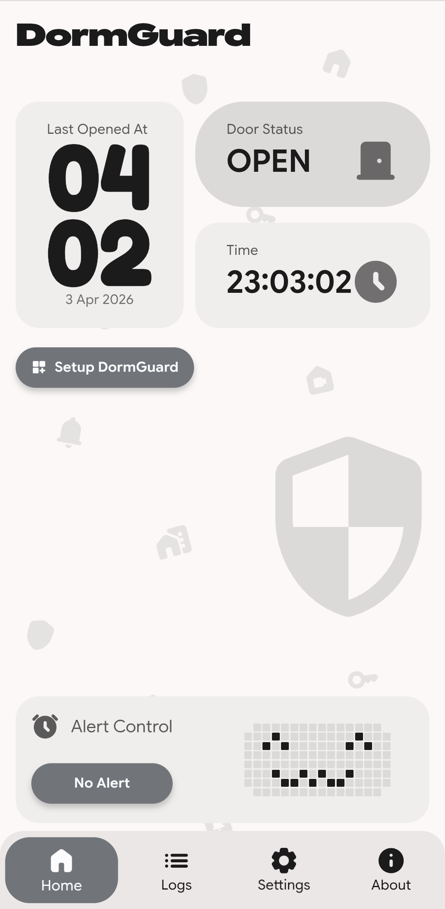
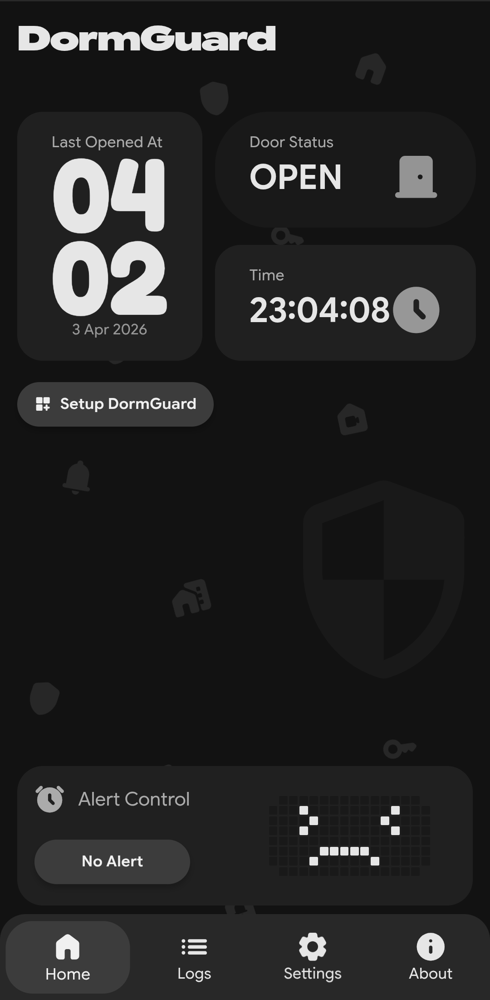
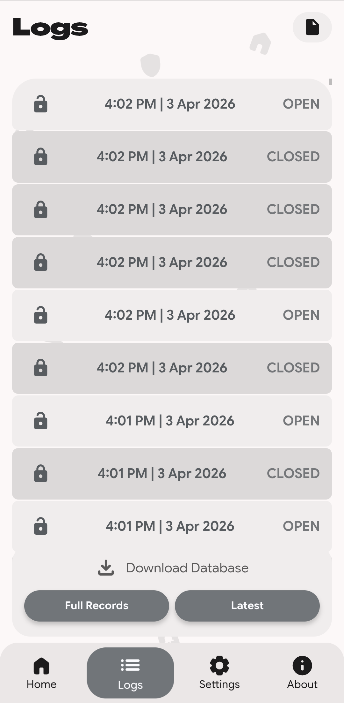
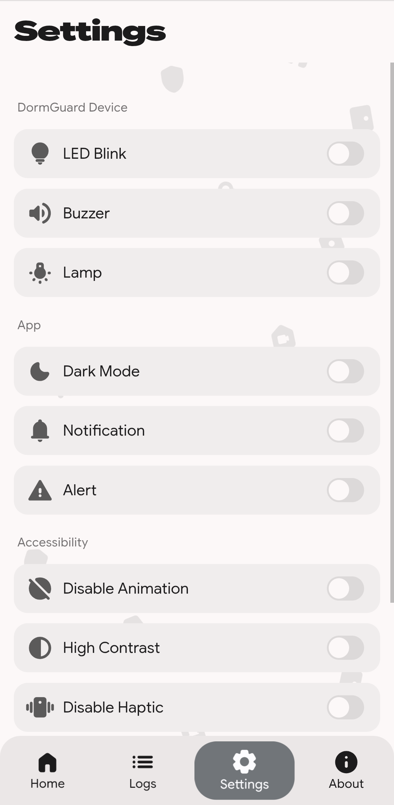
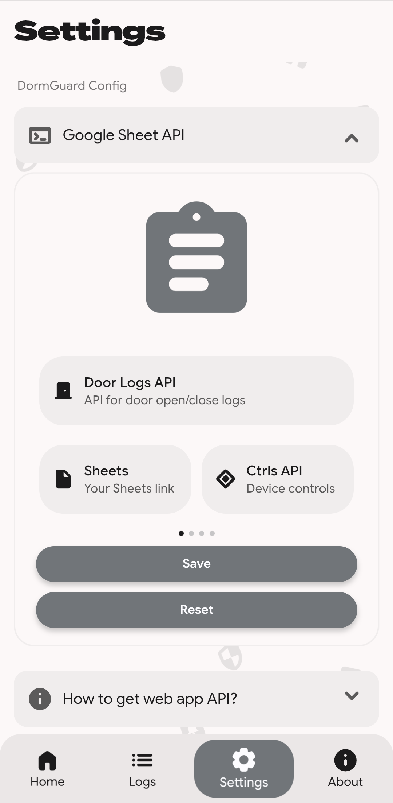
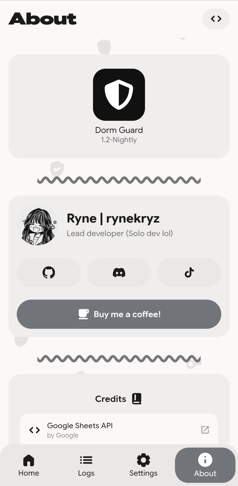

<div align="center">

<!-- decor:top -->
<picture><source media="(prefers-color-scheme: dark)" srcset="https://raw.githubusercontent.com/rynekryz/rynekryz/main/pixel-art/sky-banner-dark.svg"></picture>

<picture><source media="(prefers-color-scheme: dark)" srcset="https://raw.githubusercontent.com/rynekryz/rynekryz/main/pixel-art/divider-dots-dark.svg"></picture>
<!-- /decor:top -->


<h1>DormGuard</h1>
<p>A dorm security device that pairs an Android app with an ESP32.</p>
<p>Real-time door alerts, a motion lamp, and event logs, with the firmware included in <code>Device/</code>.</p>
</div>
<p align="center">
  <a href="https://github.com/rynekryz/dormguard/stargazers"></a>
  <a href="https://github.com/rynekryz/dormguard/tags"></a>
  <a href="LICENSE"></a>
  
  
</p>

<p align="center">
  <a href="https://github.com/rynekryz/dormguard/releases"></a>
</p>

<div align="center">
<picture><source media="(prefers-color-scheme: dark)" srcset="https://raw.githubusercontent.com/rynekryz/rynekryz/main/pixel-art/divider-dots-dark.svg"></picture>
</div>

## Screenshots

<div align="center">






</div>

<div align="center">
<picture><source media="(prefers-color-scheme: dark)" srcset="https://raw.githubusercontent.com/rynekryz/rynekryz/main/pixel-art/divider-dots-dark.svg"></picture>
</div>

## Features

- Real-time door status, straight from the ESP32 to your phone
- An alert when the door's been open too long
- Silence it from anywhere, and it stays quiet until the door reopens
- Auto timeout after 20s in case you forget to stop it
- PIR motion auto lamp, with a remote on/off toggle
- NeoPixel strip that blinks as an alert and doubles as a lamp (blink blink)
- Buzzer that goes beep beep Beep BEEP, with a switch to mute it
- LED indicator you can toggle from the app too
- Door events logged to Google Sheets (free database lol)
- Alert state stays in sync between the ESP and the app through Apps Script
- Vibration on alerts, with a toggle in settings
- Logs with date and time, last opened, and CSV export
- Dark, light, high contrast, and a reduce motion option for people who hate animation
- Material 3 Expressive
- etc.

<div align="center">
<picture><source media="(prefers-color-scheme: dark)" srcset="https://raw.githubusercontent.com/rynekryz/rynekryz/main/pixel-art/divider-dots-dark.svg"></picture>
</div>

## Technical Stack

- **UI:** Android Views, WebView and Material 3
- **Bridge:** JavaScript interface between the WebView and Kotlin
- **Alerts:** foreground service and notifications
- **Device:** ESP32 firmware (Arduino C++)
- **Language:** Kotlin and C++
- **Build:** Gradle (Kotlin DSL)

<div align="center">
<picture><source media="(prefers-color-scheme: dark)" srcset="https://raw.githubusercontent.com/rynekryz/rynekryz/main/pixel-art/divider-dots-dark.svg"></picture>
</div>

## Building

You'll need Android SDK 35+ (or Android Studio) and Java 11+.

### In Android Studio

1. Clone the repo and open it in Android Studio.
2. Connect a device or start an emulator, then hit **Run**.

### From the command line

```bash
git clone https://github.com/rynekryz/dormguard.git
cd dormguard
./gradlew build
```

The APK ends up in `app/build/outputs/apk/debug/app-debug.apk`.

<div align="center">
<picture><source media="(prefers-color-scheme: dark)" srcset="https://raw.githubusercontent.com/rynekryz/rynekryz/main/pixel-art/divider-dots-dark.svg"></picture>
</div>

## Project Structure

```
DormGuard/
├── app/src/main/java/com/rynekryz/dormguard/
│   ├── MainActivity.kt
│   ├── bridge/
│   ├── notifications/
│   └── webview/
├── Device/
│   ├── dormguard.cpp
│   └── notes.txt
└── user-manual/
```

<div align="center">
<picture><source media="(prefers-color-scheme: dark)" srcset="https://raw.githubusercontent.com/rynekryz/rynekryz/main/pixel-art/divider-dots-dark.svg"></picture>
</div>

## License

Licensed under GPL-3.0. See [LICENSE](LICENSE).

<!-- decor:bottom -->
<div align="center">

<picture><source media="(prefers-color-scheme: dark)" srcset="https://raw.githubusercontent.com/rynekryz/rynekryz/main/pixel-art/divider-wave-dark.svg"></picture>

<picture><source media="(prefers-color-scheme: dark)" srcset="https://raw.githubusercontent.com/rynekryz/rynekryz/main/pixel-art/sticker-heart-dark.svg"></picture> <picture><source media="(prefers-color-scheme: dark)" srcset="https://raw.githubusercontent.com/rynekryz/rynekryz/main/pixel-art/sticker-sparkle-dark.svg"></picture> <picture><source media="(prefers-color-scheme: dark)" srcset="https://raw.githubusercontent.com/rynekryz/rynekryz/main/pixel-art/sticker-moon-dark.svg"></picture> <picture><source media="(prefers-color-scheme: dark)" srcset="https://raw.githubusercontent.com/rynekryz/rynekryz/main/pixel-art/sticker-flower-dark.svg"></picture> <picture><source media="(prefers-color-scheme: dark)" srcset="https://raw.githubusercontent.com/rynekryz/rynekryz/main/pixel-art/sticker-cat-dark.svg"></picture> <picture><source media="(prefers-color-scheme: dark)" srcset="https://raw.githubusercontent.com/rynekryz/rynekryz/main/pixel-art/sticker-ghost-dark.svg"></picture> <picture><source media="(prefers-color-scheme: dark)" srcset="https://raw.githubusercontent.com/rynekryz/rynekryz/main/pixel-art/sticker-lock-dark.svg"></picture>

</div>
<!-- /decor:bottom -->

<div align="center">
<strong>Made with ♥︎ by Ryne</strong>
</div>
<div align="center">
  <a href="https://discord.gg/YKhWXXhKmC"></a>
  <a href="https://tiktok.com/@rynekryz"></a>
</div>
